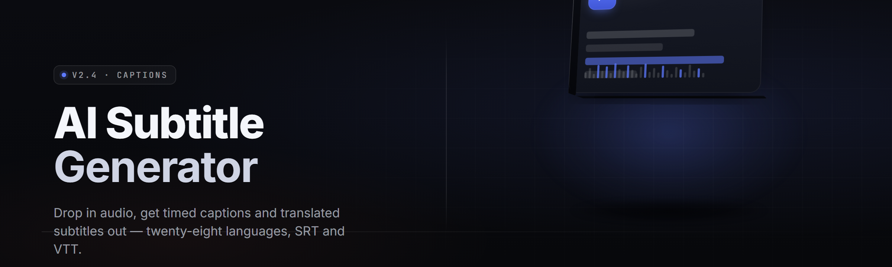

  
  
  

  

  
  
  

---

**The offline-first .exe that turns any video or audio file into broadcast-grade subtitles and burned-in captions — Whisper-grade ASR, speaker diarization, 40+ languages, one window, zero cloud uploads.**

---

## 🎬 Overview

A single portable `.exe` that watches a folder, hears the speech, and writes `.srt` / `.ass` / `.vtt` files that actually match what people said. No account, no API key, no per-minute billing, no "your file is being processed" tab you have to babysit. Drop media in, pick a preset, hit generate, walk away.

| Category | Details |
|---|---|
| Core engine | Local Whisper-family ASR + VAD + forced-alignment pass |
| Input formats | MP4, MKV, MOV, AVI, WEBM, MP3, WAV, FLAC, M4A, OGG, OPUS |
| Output formats | SRT, VTT, ASS/SSA, TTML, TXT, JSON, CSV (word-level timing) |
| Languages | 42 auto-detected + 11 manual-only dialects |
| Hardware | CPU fallback, CUDA 12+, DirectML, ROCm (AMD), Apple Silicon via WSL |
| Model sizes | tiny / base / small / medium / large-v3 / distil-large |
| UI | Native Win32 + WebView2 preview pane |
| Distribution | Portable `.exe`, no installer, no registry writes |

The point of the project is simple: subtitle work should not require an internet connection, a subscription, or trusting a third party with your footage. Everything runs on your machine. Models download once, then the network cable can be unplugged.

---

## 📖 What is "AI Subtitle & Caption Generator"?

| Term | Explanation |
|---|---|
| **ASR** | Automatic Speech Recognition — the model that turns audio into raw text with timestamps. |
| **VAD** | Voice Activity Detection — trims silence so the ASR pass doesn't hallucinate inside gaps. |
| **Diarization** | Splitting audio by speaker so `[SPEAKER_1]` and `[SPEAKER_2]` labels attach correctly. |
| **Forced alignment** | Re-timing raw ASR output to word boundaries so karaoke-style captions stay tight. |
| **Hallucination** | When the model invents text during music or silence. VAD + repetition penalty suppress it. |
| **Burned-in captions** | Subtitles rendered directly into the video pixels via ffmpeg's `subtitles` filter. |
| **Whisper family** | OpenAI's open ASR weights; this tool ships GGUF + CTranslate2 conversions. |

**Why people pick it over cloud tools:**
- Runs offline — no uploads, no rate limits, no data retention questions.
- Word-level timing built in, so karaoke and highlight-reel captions work out of the box.
- Batch queue processes a whole season folder overnight.
- Translation pass reuses the same pipeline, so a Japanese episode can ship with English `.srt` and burned-in captions in one click.
- The `.exe` is portable — copy it to a USB stick, run it on any Windows box.

  

---

## 🧩 Grouped Module Catalog

### 🎙️ Capture & Ingest

**Audio Decode** — libav-based demuxer pulls audio from any container ffmpeg reads.
**VAD Trim** — Silero VAD strips silence so the ASR pass stops hallucinating on music beds.
**Channel Split** — separates stereo tracks so left/right speaker channels can be diarized independently.
**Sample Rate Normalize** — resamples to 16 kHz mono for the model, keeps the original for burn-in.
**Loudness Gate** — skips segments under a configurable LUFS floor to avoid false triggers.
**Chunk Router** — splits long files into 30-second windows with 2-second overlap to bound memory.

### 🧠 Recognition Core

**Whisper Loader** — picks tiny → large-v3 based on available VRAM and your latency budget.
**Beam Search Tuner** — exposes beam width, patience, and length penalty in the advanced panel.
**Temperature Fallback** — retries low-confidence segments with rising temperature before giving up.
**Repetition Guard** — n-gram blocking kills the classic "thank you thank you thank you" loop.
**Language Detect** — auto-detects 42 languages; manual override for 11 dialects.
**Prompt Bias** — injects names, jargon, and product terms so the model spells them right.
**Diarization** — pyannote-derived segmenter labels speakers, mergeable or kept as `[SPEAKER_n]`.

### 💬 Caption Craft

**Sentence Splitter** — breaks ASR blobs into readable lines at clause boundaries, not mid-word.
**CPS Limiter** — caps characters-per-second so fast dialogue stays legible.
**Line Balance** — re-wraps to two lines max, roughly equal width, per broadcast convention.
**Karaoke Timing** — emits `<00:00:01.200>` ASS tags for word-by-word highlighting.
**Profanity Filter** — optional bleep-out or `[bleep]` substitution at export time.
**Style Presets** — Netflix, BBC, broadcast, and "YouTube casual" presets ship in the box.
**Speaker Colorizer** — assigns per-speaker colors in ASS output.

### 🌍 Translation & Localization

**Translate Pass** — routes ASR output through a local NLLB or Opus-MT model.
**Bilingual Export** — writes dual-language `.ass` with original on top, translation below.
**Glossary Lock** — keeps character names and technical terms untranslated.
**Timing Preserve** — translation reuses original timestamps so burn-in stays in sync.
**RTL Support** — proper shaping and bidi ordering for Arabic, Hebrew, Farsi.
**CJK Line Break** — avoids breaking Japanese/Chinese/Korean lines at illegal points.

### 🎞️ Render & Export

**SRT Writer** — plain subtitle file, universally accepted.
**VTT Writer** — WebVTT with cue styling for web players.
**ASS/SSA Writer** — full styling, positioning, karaoke tags.
**Burn-In Pass** — ffmpeg `subtitles` filter renders captions into pixels, hardware-accelerated.
**Audio-Only Export** — dumps a clean mono WAV of the detected speech for review.
**Word-Level JSON** — machine-readable timing data for downstream tooling.
**Batch Manifest** — CSV of every input, output, language, and confidence score.

### ⚙️ Workflow & Control

**Watch Folder** — drops new files into the queue automatically.
**Preset Manager** — save a full pipeline config as `.aspreset` and reload it.
**CLI Mode** — `.exe --input ep01.mkv --lang auto --preset netflix` for scripting.
**GPU Scheduler** — queues jobs across multiple GPUs, one at a time per device.
**Resume Markers** — interrupted jobs pick up from the last completed chunk.
**Log Viewer** — per-job log with timing breakdowns, no terminal needed.

### 🔒 Privacy & Storage

**Offline Mode** — hard-blocks all outbound network calls once models are cached.
**Model Vault** — stores weights under `%APPDATA%\aisc\models\`, deletable per-model.
**Temp Cleanup** — wipes intermediate WAVs on job completion unless kept.
**Portable Profile** — run from USB with all config in a local `.\data\` folder.

---

## 📊 Module Status

| Module | Status | Description |
|---|---|---|
| Audio Decode | ✅ Working | libav demuxer, all common containers |
| VAD Trim | ✅ Working | Silero VAD, configurable threshold |
| Channel Split | ✅ Working | Stereo-to-mono per-channel pipeline |
| Whisper Loader | ✅ Working | tiny → large-v3, GGUF + CT2 |
| Beam Search Tuner | ✅ Working | Full beam/patience/penalty control |
| Temperature Fallback | ✅ Working | Escalating retry on low confidence |
| Repetition Guard | ✅ Working | n-gram blocking, tunable |
| Language Detect | ✅ Working | 42 langs auto, 11 manual |
| Prompt Bias | ✅ Working | Initial-prompt injection field |
| Diarization | ✅ Working | pyannote-derived, 2–8 speakers |
| Sentence Splitter | ✅ Working | Clause-boundary splitting |
| CPS Limiter | ✅ Working | Broadcast-legible cap |
| Line Balance | ✅ Working | Two-line rebalance |
| Karaoke Timing | ✅ Working | ASS word-level tags |
| Profanity Filter | ✅ Working | Bleep or `[bleep]` mode |
| Style Presets | ✅ Working | Netflix/BBC/broadcast/YT |
| Speaker Colorizer | ✅ Working | Per-speaker ASS colors |
| Translate Pass | ✅ Working | NLLB + Opus-MT local |
| Bilingual Export | ✅ Working | Dual-language ASS |
| Glossary Lock | ✅ Working | Term protection list |
| Timing Preserve | ✅ Working | Timestamp reuse across translate |
| RTL Support | ✅ Working | Arabic/Hebrew/Farsi shaping |
| CJK Line Break | ✅ Working | Legal break-point rules |
| SRT Writer | ✅ Working | SubRip output |
| VTT Writer | ✅ Working | WebVTT with cue styling |
| ASS/SSA Writer | ✅ Working | Styled, positioned output |
| Burn-In Pass | ✅ Working | ffmpeg filter, HW-accelerated |
| Audio-Only Export | ✅ Working | Mono speech WAV |
| Word-Level JSON | ✅ Working | Machine-readable timing |
| Batch Manifest | ✅ Working | Per-run CSV summary |
| Watch Folder | ✅ Working | Auto-queue on new files |
| Preset Manager | ✅ Working | `.aspreset` save/load |
| CLI Mode | ✅ Working | Full headless operation |
| GPU Scheduler | ✅ Working | Multi-GPU queue |
| Resume Markers | ✅ Working | Chunk-level restart |
| Log Viewer | ✅ Working | In-app per-job log |
| Offline Mode | ✅ Working | Network hard-block |
| Model Vault | ✅ Working | Per-model delete |
| Temp Cleanup | ✅ Working | Auto-wipe intermediates |
| Portable Profile | ✅ Working | USB-safe config |

---

## 🚀 Get Started

1. **Download** the `.exe` from the project landing page and extract the archive to a folder you can write to (not `C:\Program Files`).
2. **First run** — the app opens, detects your GPU, and offers to download a starter model (recommended: `small` for CPU, `large-v3` for 8 GB+ VRAM).
3. **Drop a file** onto the window, or point the watch folder at a directory.
4. **Pick a preset** — Netflix, broadcast, or YouTube casual.
5. **Hit Generate.** Output lands next to the source file unless you set an output directory.

---

## 📥 Installation

1. **Extract.** Right-click the downloaded archive → *Extract All*. Windows Defender SmartScreen may warn on first launch — click *More info* → *Run anyway* (unsigned community build).
2. **Run the `.exe`.** No installer, no admin rights required for the portable build. A `data\` folder is created next to the executable on first run.
3. **Fetch models.** Open *Settings → Models* and download the size you want. Models are cached locally and can be deleted any time from the Model Vault.

---

## 🖥️ System Requirements

| Component | Minimum | Recommended |
|---|---|---|
| OS | Windows 10 21H2 (x64) | Windows 11 23H2+ |
| CPU | 4-core x64, AVX2 | 8-core x64, AVX-512 |
| RAM | 8 GB | 32 GB |
| GPU | DirectML-capable iGPU | NVIDIA RTX 3060+ (12 GB VRAM) |
| VRAM | 2 GB (tiny model) | 12 GB (large-v3) |
| Disk | 3 GB free | 40 GB free (all models + cache) |
| Runtime | VC++ 2015–2022 Redist | VC++ 2015–2022 Redist |
| Audio | Any DirectSound device | — |

---

## 🎯 Usage Guidelines

| Allowed | Not allowed |
|---|---|
| Subtitling your own footage | Re-uploading copyrighted subs to paid platforms |
| Transcribing interviews with consent | Transcribing private conversations without consent |
| Fan translation of media you own | Distributing translated subs of media you don't |
| Mixing into your own videos | Reselling the tool as a closed service |
| Research and accessibility work | Any use that violates local law |

---

## 🔑 Hotkeys

| Shortcut | Action |
|---|---|
| `Ctrl+O` | Open file |
| `Ctrl+Shift+O` | Open folder as batch |
| `Space` | Play / pause preview |
| `← / →` | Seek ∓5 s |
| `Ctrl+Enter` | Start queue |
| `Ctrl+S` | Export current subtitle |
| `Ctrl+L` | Toggle log panel |
| `F5` | Reload model |

---

## 🧪 The Problem

- Cloud subtitle services bill per minute and cap your monthly quota.
- Free web tools upload your footage to a server you don't control.
- Whisper CLI is powerful but has no preview, no burn-in, no diarization, no batch UI.
- Auto-generated YouTube captions mangle names, mis-hear jargon, and ignore speakers.
- Getting karaoke-style timing usually means a second tool, a second pass, a second sync problem.
- Long files OOM on 8 GB boxes with naive implementations.
- Nothing handles the "season folder → 12 finished `.srt` files" workflow without scripting.

---

## 🛠️ The Solution

| Problem | Solution |
|---|---|
| Per-minute billing | Fully local inference, no metering |
| Upload privacy risk | Offline Mode hard-blocks network |
| Whisper CLI friction | GUI preview + burn-in + batch |
| Mangled names | Prompt Bias field + Glossary Lock |
| Speaker labels missing | Built-in diarization |
| Karaoke timing needs a second tool | Word-level ASS export in one pass |
| OOM on long files | Chunk Router with overlap + resume |
| Season-folder workflow | Watch Folder + Batch Manifest |

---

## 🔄 Comparison

| Aspect | Cloud services | Whisper CLI | This Tool |
|---|---|---|---|
| Cost | Per-minute | Free | Free |
| Privacy | Upload required | Local | Local |
| Preview | Web player | None | Built-in player |
| Diarization | Paid tier | Manual | Built-in |
| Burn-in | Extra step | ffmpeg by hand | One click |
| Karaoke timing | Rare | No | ASS word tags |
| Batch | Limited | Script it | Queue + watch folder |
| Portable | No | Depends | Portable `.exe` |

---

## 🧯 Known Issues

| Issue | Solution |
|---|---|
| First model download stalls | Retry from *Settings → Models*, or place the file manually in `%APPDATA%\aisc\models\`. |
| GPU not detected | Update to latest NVIDIA/AMD driver; check *Settings → Hardware → Force backend*. |
| Hallucinated lines during music | Raise VAD threshold to `0.6` and enable Repetition Guard. |
| Burn-in out of sync on VFR video | Convert source to CFR with ffmpeg before burn-in. |
| Diarization labels swap mid-file | Lock speaker count in the diarization panel. |
| SmartScreen warning on launch | Unsigned build — click *More info → Run anyway*. |

---

## 💡 Tips for Best Results

- Feed the model clean 16 kHz mono audio when you can — the app will do it, but pre-cleaned audio saves a pass.
- Use the Prompt Bias field for every episode: paste character names, place names, and recurring jargon.
- For interviews, enable diarization *before* the ASR pass so labels attach on the first run.
- Keep `large-v3` for archival work and `small` for quick drafts — you can swap per job.
- Set the watch folder to your capture directory and let the queue run overnight.
- If burn-in looks soft, bump the ASS font size and re-render — no re-transcription needed.
- Export word-level JSON alongside the `.srt` if you plan to build highlight reels later.

---

## 📋 Key Features

| Feature | Description | Benefit |
|---|---|---|
| Offline ASR | Local Whisper-family inference | No uploads, no billing |
| 42 languages | Auto-detected, 11 manual | Global media coverage |
| Diarization | 2–8 speaker labels | Interview-ready output |
| Word-level timing | Per-token timestamps | Karaoke + highlight reels |
| Burn-in | Hardware-accelerated ffmpeg | Finished video in one click |
| Batch queue | Season-folder processing | Overnight runs |
| Watch folder | Auto-queue on drop | Zero-touch pipeline |
| Preset manager | Save/load pipelines | Repeatable results |
| CLI mode | Headless scripting | CI and server use |
| Translation pass | Local NLLB / Opus-MT | Bilingual export |
| Glossary lock | Protect names and terms | Correct spelling every time |
| Portable profile | USB-safe config | Move between machines |

---

## ❓ FAQ

**1. Does this need an internet connection?**
Only for the initial model download. After that, Offline Mode blocks every outbound call and the pipeline runs entirely on your machine.

**2. Is it really free?**
Yes. No account, no API key, no per-minute meter. Models are open weights; the app is MIT-licensed.

**3. What GPU do I need?**
Any DirectML-capable GPU will run the tiny and base models. For `large-v3` on a long file, an RTX 3060 with 12 GB VRAM is the comfortable floor. CPU-only works but is much slower.

**4. Can it burn subtitles into the video?**
Yes — the Burn-In Pass renders captions into the pixels via ffmpeg's `subtitles` filter, hardware-accelerated when available.

**5. Does it handle multiple speakers?**
Yes. Diarization labels 2–8 speakers and can either merge them or keep `[SPEAKER_n]` prefixes in the output.

**6. Can I translate while transcribing?**
Yes. The Translate Pass runs after ASR and reuses the same timestamps, so a bilingual `.ass` is one job.

**7. Will it work on a laptop without a discrete GPU?**
It will, on CPU, using the tiny or base model. Expect roughly real-time to 3× real-time depending on your CPU.

**8. Why does SmartScreen flag the `.exe`?**
It's an unsigned community build. Click *More info → Run anyway* once, or verify the SHA-256 hash on the landing page.

**9. Can I script it?**
Yes — `.exe --input file.mkv --lang auto --preset netflix --out .\subs\` runs headless with full preset control.

**10. Where are my models stored?**
Under `%APPDATA%\aisc\models\`, or in `.\data\models\` if you're running the portable profile. Each model can be deleted individually from the Model Vault.

---

Built for people who subtitle their own footage and want the pipeline to stay on their machine. The `.exe` is the whole product — no installer, no service, no account. Grab it, drop a file, and watch the captions write themselves.

  

